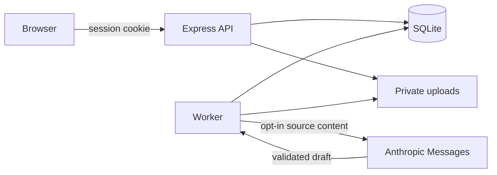

<!-- generated-by: gsd-doc-writer -->

# Architecture

## Components

`src/App.tsx` implements authentication, workspace selection, navigation and record workflows. `src/ui.tsx` holds shared display components and native dialogs. `src/types.ts` defines client contracts and the fetch helper. `src/styles.css` includes responsive layouts and locally bundled fonts.

`server/app.js` creates the Express application. `server/db.js` creates SQLite tables and a small transaction/record repository. `server/processor.js` extracts source evidence, calls Anthropic and persists draft materials. `server/index.js` starts the HTTP server and one worker.

## Data and authorization

Users, sessions, workspaces, memberships and audit events are relational tables. Media, journals, procedures and assignments live in workspace-scoped JSON records with type indexes. SQLite runs in WAL mode with foreign keys enabled. Local persistence is in `DATA_DIR`.

Sessions contain random 32-byte tokens; only their SHA-256 hashes are stored. Passwords use salted scrypt. Session cookies are HttpOnly, SameSite Strict and expire after seven days. Secure cookies are enabled through configuration. Membership is checked before every workspace endpoint, including original-file access. Members cannot edit/approve procedures or assign training. Reviewers can edit and submit drafts; only owners approve and add members.

Record mutations and associated audit events share transactions. The audit API returns the most recent 500 events. Application clients cannot edit audit events; this is not cryptographic tamper-proof storage against database administrators.

## State machines

Media: `stored` or `waiting_configuration` -> `queued` -> `processing` -> `draft`, `blocked`, or `failed`. Restart resets interrupted processing to queued. Stored, failed, blocked and waiting files may be queued manually. Only one job is processed at a time. Completed drafts cannot be regenerated from the same file through retry.

Procedures: `draft` -> `review` -> `approved`. Review may return to draft. Approved content is immutable through editing routes; revision creates a new draft record linked to the original. Updates and transitions require the current version. Assignments contain a full approved snapshot. Only the assigned user can acknowledge it.

## AI boundaries

Sources are untrusted. The prompt disallows embedded instructions and restricts generation to general operational material. Tool output is schema validated, out-of-scope output is discarded, and no generated draft is automatically approved. General operations images and text are supported; videos contribute sampled visual frames only. Provider errors leave retryable records with sanitized messages.

## Deployment constraints

One server process, local SQLite and private filesystem storage. Do not run multiple workers/replicas against this architecture. To scale, replace disk storage with authorized object storage, add a proper job queue/lease, and migrate the database. No external service credentials are bundled into the frontend.
